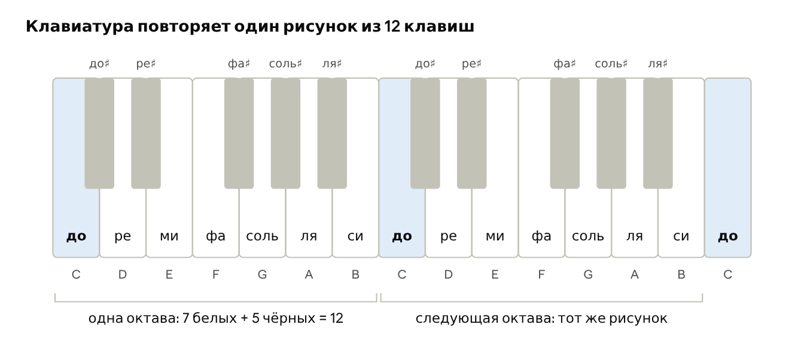
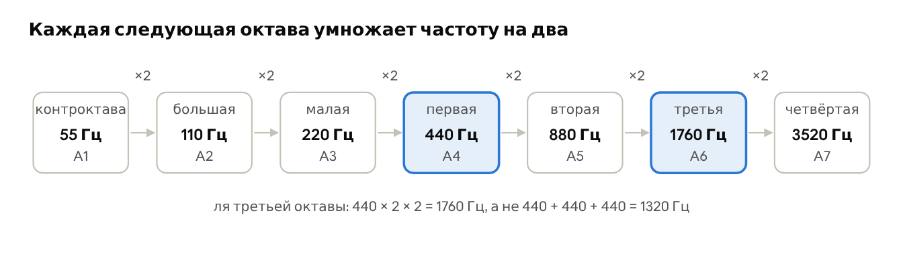
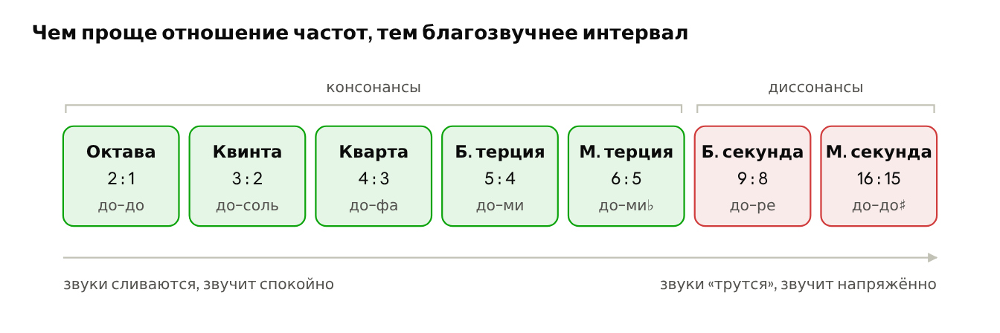
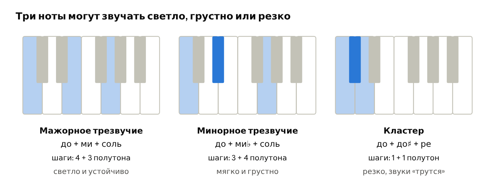

# Глава 1. Знакомство с теорией музыки

Эта глава даёт минимум теории, нужный для всех остальных: что такое ноты, как устроена клавиатура и почему одни сочетания звуков приятны, а другие режут слух. Все термины, выделенные **жирным**, есть в [словаре](99-slovar.md).

## 1.1. Звук и высота

Звук — это колебания воздуха. Струна гитары, мембрана барабана или динамик колонки дрожат и толкают воздух, а ухо улавливает эти толчки. Чем чаще колебания, тем **выше** звук. Число колебаний в секунду называют **частотой** (frequency) и измеряют в герцах (Гц). Например, нота ля, по которой настраивают оркестры, звучит на частоте 440 Гц.

> 👂 **Попробуйте.** Нажмите самую левую клавишу, затем самую правую: низкий звук гудит, высокий звенит. Теперь пропойте любую удобную ноту и попробуйте найти её на клавиатуре: если клавиша звучит выше вашего голоса, идите влево, если ниже — вправо.

У звука есть и другие свойства: **громкость** (volume) — насколько сильны колебания, **длительность** (duration) — сколько длится, и **тембр** (timbre) — «окраска», по которой мы отличаем фортепиано от скрипки, даже когда они играют одну и ту же ноту.

> 👂 **Попробуйте.** Выберите в приложении-пианино или на синтезаторе другой звук (орган, гитару, флейту) и сыграйте одну и ту же клавишу разными звуками. Высота одна, а «голос» разный — это и есть тембр. Затем нажмите клавишу сначала слабо, потом сильно: на пианино меняется громкость. Держите клавишу и отпускайте сразу — меняется длительность.

## 1.2. Ноты и клавиатура

**Нота** (note) — это звук определённой высоты и его название. Основных названий всего семь: до, ре, ми, фа, соль, ля, си. В англоязычных инструкциях и на приборах их обозначают буквами C, D, E, F, G, A, B. Дальше названия повторяются: после си снова идёт до, только выше.

### 1.2.1. Как обозначают ноты

У нот есть две системы названий, и обе понадобятся.

**Слоговые названия** (solfège) — до, ре, ми, фа, соль, ля, си. Их придумал в XI веке итальянский монах Гвидо д’Ареццо, учивший певчих. Он взял латинский гимн, в котором каждая строка начиналась на ступень выше предыдущей, и назвал ноты первыми слогами строк: Ut, Re, Mi, Fa, Sol, La. Позже неудобное для пения ut заменили на do, а седьмую ноту назвали si — по первым буквам слов Sancte Iohannes из последней строки. Этими названиями пользуются в России, Италии, Франции, Испании.

**Буквенные названия** (letter names) — латинские буквы A, B, C, D, E, F, G. Они старше слоговых и приняты в англоязычных странах, на электронных инструментах, в программах и инструкциях. Соответствие такое: до = C, ре = D, ми = E, фа = F, соль = G, ля = A, си = B. В немецкой традиции си обозначают буквой H, а B там означает си-бемоль, поэтому в старых сборниках встречаются аккорды H и B.

Чтобы отличить одинаковые ноты в разных частях клавиатуры, к букве добавляют номер октавы: C4 — это до в середине фортепиано (по-русски «до первой октавы»), C5 — следующее до справа, A4 — то самое ля на 440 Гц.

> 💡 **Почему английский ряд начинается с C, а не с A?** Алфавит начинается с A, потому что в древней и средневековой теории звукоряд строили от ля: она была самой нижней нотой системы. Потом главным ладом европейской музыки стал **мажор** (major), а мажор на одних белых клавишах получается только от до. Поэтому учебники, клавиатуры и нумерация октав стали начинаться с C (C4, D4 … B4, затем C5), а буквы переименовывать не стали. Так C оказалась «первой» нотой, а A — шестой.

Удобнее всего увидеть ноты на фортепианной клавиатуре ([фото и история инструмента в Википедии](https://ru.wikipedia.org/wiki/Фортепиано)). Каждая клавиша — одна нота, слева низкие, справа высокие. Белые клавиши носят семь основных названий, чёрные — промежуточные ноты между ними.

*Две октавы фортепианной клавиатуры с названиями нот; клавиши «до» подсвечены*

Чёрные клавиши стоят группами по две и по три, и по этому рисунку легко ориентироваться: **до** всегда стоит сразу слева от пары чёрных, а **фа** — слева от тройки. Между ми и фа, между си и до чёрной клавиши нет: эти ноты и так стоят вплотную. Каждая чёрная клавиша имеет два имени: та, что между до и ре, — это и до♯ (до-**диез**, «до, чуть повышенная»), и ре♭ (ре-**бемоль**, «ре, чуть пониженная»). На схеме подписано только первое имя, чтобы не загромождать рисунок.

> 👂 **Попробуйте.** Не глядя на схему, найдите на клавиатуре все «фа» (слева от тройки чёрных). Затем сыграйте подряд до и до♯: чёрная клавиша звучит чуть выше белой слева и чуть ниже белой справа.

## 1.3. Октава, тон и полутон

**Октава** (octave) — расстояние от ноты до следующей ноты с тем же названием, например от одного до до следующего. На схеме выше это 12 клавиш: 7 белых и 5 чёрных. Частота верхней ноты ровно вдвое больше нижней (ля 440 Гц и ля 880 Гц), поэтому ухо слышит их как «одну и ту же ноту, только выше».

> 👂 **Попробуйте.** Нажмите до, потом следующее до справа, а затем оба вместе: они почти сливаются в один звук. Для сравнения нажмите вместе до и си чуть ниже верхнего до: разница всего в одну клавишу, а звуки уже не сливаются, а спорят.

> 💡 **Частоты умножаются, а не складываются.** Каждая следующая октава вдвое выше предыдущей. Ля первой октавы — 440 Гц, второй — 880 Гц, третьей — 1760 Гц, а не 1320. Поэтому в низких октавах соседние ноты отличаются на единицы герц, а в высоких — на сотни, хотя на слух шаг одинаковый. Полутон — это тоже умножение: каждая следующая клавиша примерно в 1,06 раза выше предыдущей, и за 12 таких шагов частота ровно удваивается.

*Нота ля в семи октавах: частота каждый раз удваивается*

### 1.3.1. Врезка: как слышит ухо

Ухо сравнивает звуки не по разнице, а по **отношению**: для него «вдвое выше» звучит одинаково и в басу, и в писке. Такую шкалу, где равные шаги — это равные умножения, называют **логарифмической**. Человек слышит примерно от 20 Гц до 20 000 Гц — это около десяти октав; с возрастом верхняя граница снижается.

С **громкостью** та же история. Её измеряют в **децибелах** (дБ, decibels), и эта шкала тоже логарифмическая: каждые +10 дБ означают, что мощность звука выросла в 10 раз, но на слух это воспринимается примерно как «вдвое громче». Два одинаковых инструмента вместо одного дают всего +3 дБ — разница едва заметна.

| Звук | Примерная громкость |
| --- | --- |
| шёпот | 30 дБ |
| обычный разговор | 60 дБ |
| оживлённая улица | 70–80 дБ |
| рок-концерт, клуб | 100–110 дБ |
| болевой порог | около 120–130 дБ |

> ⚠️ **Внимание: берегите слух.** Долгое прослушивание звуков громче примерно 85 дБ повреждает слух, и это необратимо. Занимаясь в наушниках, ставьте громкость так, чтобы свободно слышать собеседника, и делайте перерывы.

> 👂 **Попробуйте.** Сыграйте все «ля» на клавиатуре снизу вверх: каждая следующая звучит как та же нота, поднятая на одинаковый шаг, хотя частота каждый раз удваивается. Теперь сравните две соседние клавиши в самом низу и две в самом верху: в герцах разница в сотни раз больше, а на слух это один и тот же полутон.

**Полутон** (semitone) — самое маленькое расстояние на клавиатуре: две соседние клавиши, без пропусков. Обычно это белая и соседняя чёрная, но ми–фа и си–до тоже полутоны, потому что между ними нет чёрной. **Тон** (whole tone) — два полутона, то есть одна клавиша пропущена: до–ре, фа–соль.

> 👂 **Попробуйте.** Сыграйте подряд ми → фа (полутон), а потом фа → соль (тон). Полутон — крошечный шажок, почти скольжение; тон — заметный шаг. Пропойте оба интервала вслед за клавиатурой: голос почувствует разницу лучше глаз.

Знак **диез** (♯, sharp) поднимает ноту на полутон, **бемоль** (♭, flat) опускает. До♯ и ре♭ — одна и та же клавиша, просто названная с разных сторон.

> 💡 **Диез или бемоль: какое имя выбрать?** Одна и та же чёрная клавиша имеет два имени, и музыканты выбирают его по **ладу**. Правило простое: в записи гаммы каждое название ноты встречается ровно один раз. Например, в до миноре третья ступень — это ми♭, а не ре♯: иначе в гамме было бы два «ре» и ни одного «ми». Поэтому в нотах одних пьес стоят диезы, а других — бемоли.
>
> Электронный инструмент не знает, в каком ладу вы играете, и ему проще дать каждой клавише одно постоянное имя. Обычно выбирают диезы: C, C♯, D, D♯, E, F, F♯… Так поступают, например, инструкция Novation и большинство музыкальных программ. Звучат оба варианта одинаково: до♯ и ре♭ — это одна клавиша и одна **частота**.

## 1.4. Лад и гамма

Если играть все 12 клавиш подряд, получится не мелодия, а «ползущий» звук. Музыка почти всегда выбирает из 12 нот только часть, обычно 7. Такой набор нот с главной нотой называется **лад** (mode), главная нота — **тоника** (tonic) (на ней мелодия звучит законченно, как точка в конце предложения). Порядковый номер ноты в ладу — **ступень** (scale degree): тоника — 1-я ступень, следующая — 2-я и так далее до 7-й. Ноты лада, сыгранные подряд вверх или вниз, — это **гамма** (scale).

Лад определяется тем, в каком порядке идут тоны (Т) и полутоны (П). Двух ладов достаточно на всю книгу:

**Мажор** (major) строится по порядку шагов Т Т П Т Т Т П. От до это даёт ноты до, ре, ми, фа, соль, ля, си.

**Натуральный минор** (natural minor) строится по порядку Т П Т Т П Т Т. От до это даёт ноты до, ре, ми♭, фа, соль, ля♭, си♭.

У каждого лада есть **ладовая окраска** (mood, character) — настроение, которое он обычно создаёт. Мажор чаще всего звучит светло и уверенно, натуральный минор — грустно или напряжённо. Это привычка европейской музыки, а не закон природы: быстрая мелодия в миноре может звучать задорно, а медленная в мажоре — печально. Но для начинающего окраска — хороший ориентир при выборе лада.

Лад можно построить от любой из 12 клавиш, сохранив порядок шагов. У двух ладов есть особенно удобный вариант: он получается на одних белых клавишах, без единой чёрной.

| Лад | Тоника | Ноты (только белые клавиши) |
| --- | --- | --- |
| **До мажор** | до | до, ре, ми, фа, соль, ля, си |
| **Ля минор** | ля | ля, си, до, ре, ми, фа, соль |

Обратите внимание: ноты в обоих ладах одни и те же, отличается только тоника, то есть нота, с которой начинают и на которой заканчивают. Начните на белых клавишах с до, и получится светлый мажор; начните с ля — получится грустный минор.

> 👂 **Попробуйте.** Проверьте по схеме клавиатуры: от до до ре — тон (пропущена чёрная до♯), от ми до фа — полутон (соседние). Название лада складывается из тоники и вида: **до мажор**, **ля минор**, **до минор**.

## 1.5. Гармония: почему одни звуки дружат, а другие нет

**Интервал** (interval) — расстояние между двумя нотами. Октава — один из интервалов; остальные тоже названы по номеру ступени: секунда (вторая), терция (третья), кварта (четвёртая), **квинта** (пятая, fifth). Если нажать две клавиши одновременно, одни пары сливаются в приятный звук, другие звучат резко. Первые называют **консонансами** (consonance), вторые — **диссонансами** (dissonance).

> 💡 **Почему одни пары звучат благозвучно?** У таких пар частоты соотносятся как простые дроби. У квинты это 3 : 2: пока нижняя нота делает 2 колебания, верхняя делает ровно 3, и волны часто совпадают. Ухо слышит такую пару как единое целое. У соседних клавиш (16 : 15) волны почти никогда не совпадают и то усиливают, то гасят друг друга. Это слышно как дрожание или «шероховатость» — акустики называют его **биениями** (beating).

> 👂 **Попробуйте.** Нажмите одновременно до и соль и подержите пару секунд: звуки сливаются в один крепкий, немного «пустой» звук. Теперь нажмите до и соседнюю чёрную клавишу до♯. Звук начинает дрожать и «скрипеть» — это и есть биения. Сравните ещё до + ми (светло и тепло) и до + ре (уже шершаво).

*Интервалы от самого благозвучного к самому резкому, с отношением частот и примером от до*

> 📜 **Историческая справка: пифагорейцы и монохорд.** Первыми связь между созвучием и числами описали ученики древнегреческого философа Пифагора (VI–V века до н. э.). Их прибором был **монохорд** (monochord) — одна струна, натянутая над деревянным ящиком, и подвижная подставка, которая делит её на части. Пифагорейцы заметили: если зажать струну посередине (отношение длин 2 : 1), она звучит на октаву выше; если оставить две трети (3 : 2) — на квинту; три четверти (4 : 3) — на кварту. Самые приятные созвучия получались из отношений чисел 1, 2, 3 и 4, и для пифагорейцев это стало доказательством, что весь мир устроен по законам числа. Отсюда их идея «музыки сфер»: будто планеты, двигаясь по орбитам, тоже звучат в гармонии.
>
> Поздние античные авторы пересказывали легенду, будто Пифагор открыл эти отношения, услышав в кузнице звон молотов разного веса. С точки зрения физики история неверна, но она показывает, как давно люди искали числа в звуке.
>
> Пифагорейцы строили звукоряд, откладывая квинту за квинтой. Однако 12 квинт подряд чуть-чуть не совпадают с 7 октавами: разница около 1,4 % по частоте. Её называют **пифагоровой коммой** (Pythagorean comma). Спустя почти две тысячи лет эту разницу «раздали» поровну между всеми 12 полутонами — так появилась **равномерная темперация** (equal temperament), по которой настроены фортепиано, синтезаторы и Circuit Tracks.

> 💡 **Диссонанс — это ошибка?** Нет. Он создаёт напряжение, и слух ждёт, что оно сменится спокойным созвучием. Именно эта смена «напряжение → разрядка» двигает музыку вперёд; музыка из одних консонансов звучит пресно.

> 👂 **Попробуйте.** Нажмите вместе си и фа над ним — звучит тревожно, хочется продолжения. Теперь сдвиньте оба пальца на полутон навстречу друг другу: си поднимите до до, фа опустите до ми. Напряжение «разрешилось» в спокойное до + ми. Повторите несколько раз: напряжение, разрядка.

**Аккорд** (chord) — три и больше ноты, взятые одновременно. Самый важный аккорд — **трезвучие** (triad): три ноты лада через одну (до, пропустили ре, ми, пропустили фа, соль). В нём только консонансы, поэтому оно звучит цельно. Стоит опустить среднюю ноту на полутон, и мажорное трезвучие станет минорным. А если нажать три соседние клавиши, получится **кластер** (cluster) — сплошной диссонанс.

*Мажорное и минорное трезвучие и кластер на клавиатуре; нажатые клавиши подсвечены*

> 👂 **Попробуйте.** Сыграйте вместе до, ми и соль — мажорное трезвучие. Не отпуская до и соль, переставьте средний палец с ми на чёрную клавишу левее, ми♭: аккорд стал минорным и звучит печальнее. Затем нажмите три соседние клавиши до, до♯, ре — кластер. Теперь посчитайте по схеме полутоны между соседними нотами. В мажорном трезвучии от до до ми 4 полутона, от ми до соль ещё 3. В минорном наоборот: 3, потом 4. Считайте именно шаги с клавиши на соседнюю, а не клавиши между нотами: между до и соль лежат 6 клавиш, но шагов от до до соль 7 (до♯, ре, ре♯, ми, фа, фа♯, соль). Крайние ноты в обоих аккордах отстоят на 7 полутонов — это квинта, поэтому оба звучат цельно, а настроение решает только средняя нота. В кластере шаги по 1 полутону, и все ноты «трутся» друг о друга. Напоследок загадка: сыграйте трезвучие на белых клавишах от ре (ре + фа + ля). Оно мажорное или минорное? Ответ: минорное — сравните его на слух с до + ми♭ + соль.

**Гармония** (harmony) — это то, какие ноты звучат одновременно и как созвучия сменяют друг друга. В каждом ладу есть три главных трезвучия, на которых стоит огромное количество песен. Их принято обозначать римской цифрой: это номер **ступени** лада (см. 1.4), с которой начинается аккорд. В до мажоре это:

| Ступень | Аккорд | Как звучит |
| --- | --- | --- |
| I (1-я) | до + ми + соль | «дома», покой |
| IV (4-я) | фа + ля + до | «вышли из дома», движение |
| V (5-я) | соль + си + ре | напряжение, «тянет домой» |

Последовательность I → IV → V → I — миниатюрная история: спокойствие, движение, напряжение, возвращение. Самая низкая нота аккорда обычно звучит в партии **баса**: бас подсказывает уху, какой сейчас аккорд, даже если самих аккордов никто не играет.

> 👂 **Попробуйте.** Сыграйте по очереди четыре аккорда, держа каждый 2–3 секунды: до + ми + соль, фа + ля + до, соль + си + ре и снова до + ми + соль. Задержитесь на третьем: слышно, как он тянет вернуться «домой». Затем сыграйте ту же цепочку одной левой рукой, только нижние ноты: до, фа, соль, до. Даже один бас рассказывает ту же историю.

## 1.6. 🎓 Урок 1. Занятие на клавиатуре

**Что понадобится:** любая клавиатура — пианино, синтезатор или бесплатное приложение-пианино на телефоне. Подойдёт и Circuit Tracks, но с ним удобнее начинать после главы 3. Время: 30–40 минут. Играйте одним пальцем, если так проще: сейчас важно слушать, а не техника.

### Шаг 1. Найдите все «до»

Найдите на клавиатуре все пары чёрных клавиш. Белая клавиша слева от каждой пары — **до**. Нажмите их по очереди слева направо: это одна и та же нота в разных **октавах**.

- [ ] 🎯 Нахожу «до» с первого взгляда

### Шаг 2. Гамма до мажор

От любого «до» сыграйте подряд белые клавиши вверх до следующего «до», затем вниз. Это **гамма** до мажора. Обратите внимание: последняя нота звучит как завершение. Теперь остановитесь на «си» и прислушайтесь — хочется нажать «до», правда? Это и есть притяжение **тоники**.

- [ ] 🎯 Сыграл гамму вверх и вниз и услышал, как «си» тянет к «до»

### Шаг 3. Мелодия «Ах, скажу я вам, мама»

Французская народная песня XVIII века; у нас её чаще знают как «Мерцай, мерцай, звёздочка». Каждая строка — одна **фраза**, последнюю ноту строки держите вдвое дольше.

| Фраза | Ноты | Чем заканчивается |
| --- | --- | --- |
| 1 | до до соль соль ля ля соль | на соль — звучит как вопрос |
| 2 | фа фа ми ми ре ре до | на до — ответ, точка |
| 3 | соль соль фа фа ми ми ре | на ре — вопрос |
| 4 | соль соль фа фа ми ми ре | на ре — снова вопрос |
| 5 | до до соль соль ля ля соль | на соль — вопрос |
| 6 | фа фа ми ми ре ре до | на до — окончательный ответ |

- [ ] 🎯 Сыграл мелодию целиком без остановок

### Шаг 4. «Ода к радости»

Тема из Девятой симфонии Бетховена (1824). Здесь тоже две фразы: первая кончается на ре (вопрос), вторая — на до (ответ).

| Фраза | Ноты |
| --- | --- |
| 1 | ми ми фа соль · соль фа ми ре · до до ре ми · ми ре ре |
| 2 | ми ми фа соль · соль фа ми ре · до до ре ми · ре до до |

Точки делят фразу на четыре части по четыре ноты. Последние ноты каждой фразы (ре ре и до до) держите чуть дольше.

- [ ] 🎯 Сыграл обе фразы и слышу разницу между концом первой и второй

### Шаг 5. Опыт: гармонично или нет

Нажимайте клавиши **одновременно** и держите 3–4 секунды. Слушайте не только саму высоту, но и дрожание звука.

| Что нажать | Что это | Как звучит |
| --- | --- | --- |
| до + следующее до | октава | почти как один звук |
| до + соль | квинта | пусто, но очень крепко |
| до + ми | большая терция | светло, тепло |
| до + до♯ | малая секунда | дрожит, «трётся» — слышны **биения** |
| до + ми + соль | мажорное трезвучие | светло, устойчиво |
| до + ми♭ + соль | минорное трезвучие | мягко, грустно |
| ре + фа + ля | минорное трезвучие на одних белых | тоже грустно |
| до + до♯ + ре | кластер | резко, неприятно |

Теперь объедините опыт с мелодией: сыграйте «Ах, скажу я вам, мама» правой рукой, а левой в конце каждой фразы нажмите **бас**. Под ноту соль — низкое соль, под ноту до — низкое до. Вы услышите, что бас подтверждает и вопрос, и ответ.

- [ ] 🎯 Различаю на слух консонанс и диссонанс
- [ ] 🎯 Сыграл мелодию с басом в конце фраз
