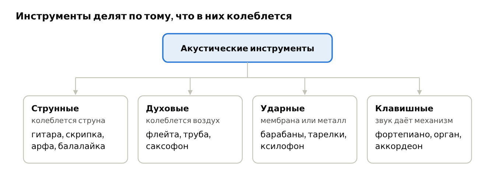
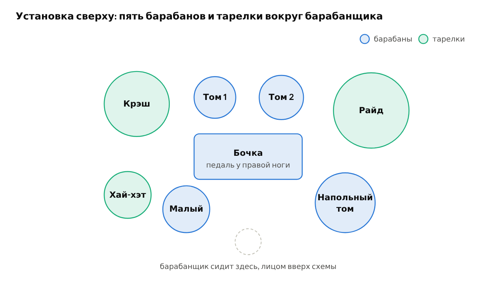

# Глава 2. Музыкальные инструменты

В этой главе мы познакомимся с тем, как инструменты получают звук, и сыграем первый **бит** (beat). Для электронной музыки это важно: синтезаторы и драм-машины во многом подражают акустическим инструментам, и слова «бочка», «малый» или «струнный пэд» пришли именно оттуда.

## 2.1. Семейства инструментов

Любой акустический инструмент делает одно и то же: заставляет что-то колебаться. По тому, что именно колеблется, инструменты делят на семейства.

*Четыре семейства акустических инструментов и примеры*

В таблице у каждого инструмента есть ссылка на статью Википедии и прямая ссылка на его изображение с Викисклада. Рядом указаны автор, лицензия и страница файла — эти данные нужно сохранять в любой версии книги.

| Инструмент | Семейство | Как получается звук | Изображение |
| --- | --- | --- | --- |
| [Гитара](https://ru.wikipedia.org/wiki/Гитара) | струнные щипковые | струну дёргают пальцем или медиатором | [Изображение](https://commons.wikimedia.org/wiki/Special:FilePath/GuitareClassique5.png) · Martin Möller · [CC BY-SA 2.0 DE](https://creativecommons.org/licenses/by-sa/2.0/de/deed.ru) · [файл](https://commons.wikimedia.org/wiki/File:GuitareClassique5.png) |
| [Скрипка](https://ru.wikipedia.org/wiki/Скрипка) | струнные смычковые | по струне ведут смычком, звук тянется | [Изображение](https://commons.wikimedia.org/wiki/Special:FilePath/Violin_VL100.png) · участник Викисклада · [CC0](https://creativecommons.org/publicdomain/zero/1.0/deed.ru) · [файл](https://commons.wikimedia.org/wiki/File:Violin_VL100.png) |
| [Арфа](https://ru.wikipedia.org/wiki/Арфа) | струнные щипковые | десятки струн, каждая — одна нота | [Изображение](https://commons.wikimedia.org/wiki/Special:FilePath/Harpist_playing.jpg) · Grendelkhan · [CC BY-SA 3.0](https://creativecommons.org/licenses/by-sa/3.0/deed.ru) · [файл](https://commons.wikimedia.org/wiki/File:Harpist_playing.jpg) |
| [Флейта](https://ru.wikipedia.org/wiki/Флейта) | деревянные духовые | воздух рассекается о край отверстия | [Изображение](https://commons.wikimedia.org/wiki/Special:FilePath/Western_concert_flute.png) · словарь Уэбстера, 1911 · общественное достояние · [файл](https://commons.wikimedia.org/wiki/File:Western_concert_flute.png) |
| [Труба](<https://ru.wikipedia.org/wiki/Труба_(музыкальный_инструмент)>) | медные духовые | колеблются губы музыканта в мундштуке | [Изображение](https://commons.wikimedia.org/wiki/Special:FilePath/Trumpet_1.jpg) · PJ · [CC BY-SA 3.0](https://creativecommons.org/licenses/by-sa/3.0/deed.ru) · [файл](https://commons.wikimedia.org/wiki/File:Trumpet_1.jpg) |
| [Саксофон](https://ru.wikipedia.org/wiki/Саксофон) | деревянные духовые | колеблется трость (тонкая пластинка), хотя корпус из металла | [Изображение](https://commons.wikimedia.org/wiki/Special:FilePath/ConnCMelodySax.JPG) · Tom Oates · [CC BY-SA 3.0](https://creativecommons.org/licenses/by-sa/3.0/deed.ru) · [файл](https://commons.wikimedia.org/wiki/File:ConnCMelodySax.JPG) |
| [Ударная установка](https://ru.wikipedia.org/wiki/Ударная_установка) | ударные | барабаны и тарелки для одного исполнителя, подробнее ниже | [Изображение](https://commons.wikimedia.org/wiki/Special:FilePath/Arthur_Rosebery,_The_Kit_Kat_Dance_Band_drum_kit,_at_Two_Temple_Place,_Astor_House.jpg) · Acabashi · [CC BY-SA 4.0](https://creativecommons.org/licenses/by-sa/4.0/deed.ru) · [файл](https://commons.wikimedia.org/wiki/File:Arthur_Rosebery,_The_Kit_Kat_Dance_Band_drum_kit,_at_Two_Temple_Place,_Astor_House.jpg) |
| [Ксилофон](https://ru.wikipedia.org/wiki/Ксилофон) | ударные с высотой | деревянные пластины разной длины, расположены как клавиши | [Изображение](https://commons.wikimedia.org/wiki/Special:FilePath/Xylophone.jpg) · Olivier Lemoine (Photo-Terroir.fr) · [CC BY-SA 3.0](https://creativecommons.org/licenses/by-sa/3.0/deed.ru) · [файл](https://commons.wikimedia.org/wiki/File:Xylophone.jpg) |
| [Фортепиано](https://ru.wikipedia.org/wiki/Фортепиано) | клавишные | клавиша приводит в движение молоточек, он бьёт по струне | [Изображение](https://commons.wikimedia.org/wiki/Special:FilePath/Steinway_%26_Sons_concert_grand_piano,_model_D-274,_manufactured_at_Steinway%27s_factory_in_Hamburg,_Germany.png) · Steinway & Sons · [CC BY-SA 3.0](https://creativecommons.org/licenses/by-sa/3.0/deed.ru) · [файл](https://commons.wikimedia.org/wiki/File:Steinway_%26_Sons_concert_grand_piano,_model_D-274,_manufactured_at_Steinway%27s_factory_in_Hamburg,_Germany.png) |
| [Орган](<https://ru.wikipedia.org/wiki/Орган_(музыкальный_инструмент)>) | клавишные духовые | клавиша пускает воздух в трубу | [Изображение](https://commons.wikimedia.org/wiki/Special:FilePath/Pipe_organ,_Adelaide_Town_Hall.jpg) · Bahudhara · [CC BY-SA 4.0](https://creativecommons.org/licenses/by-sa/4.0/deed.ru) · [файл](https://commons.wikimedia.org/wiki/File:Pipe_organ,_Adelaide_Town_Hall.jpg) |
| [Аккордеон](https://ru.wikipedia.org/wiki/Аккордеон) | клавишные язычковые | меха гонят воздух через металлические язычки | [Изображение](https://commons.wikimedia.org/wiki/Special:FilePath/Jupiter_bayan_accordion.JPG) (на фото — баян, его русская разновидность) · Henry Doktorski · [CC BY-SA 3.0](https://creativecommons.org/licenses/by-sa/3.0/deed.ru) · [файл](https://commons.wikimedia.org/wiki/File:Jupiter_bayan_accordion.JPG) |

Инструменты с определённой высотой звука (фортепиано, скрипка, ксилофон) играют **мелодию** и **гармонию**. У большинства барабанов и тарелок высота расплывчатая, и они отвечают за **ритм**.

> 👂 **Попробуйте.** Постучите костяшкой пальца по столу, а затем пропойте любую ноту. Стук голосом по высоте не повторишь — это ритмический звук. Пропетую ноту можно найти на клавиатуре — это звук с высотой. Откройте статьи из таблицы: во многих есть записи звучания, сравните на слух тембры скрипки, флейты и трубы.

## 2.2. Ударная установка

[Ударная установка](https://ru.wikipedia.org/wiki/Ударная_установка) — набор барабанов и тарелок, расставленных так, чтобы один человек доставал до всего руками и ногами. Установки называют по числу барабанов (тарелки не считают): самая распространённая — пятибарабанная, в семибарабанной просто добавлены ещё два тома. Для урока подойдёт любая.

*Классическая ударная установка, вид сверху (для правши), расположение условное*

| Элемент | Как звучит | Роль в бите |
| --- | --- | --- |
| **Бочка** (бас-барабан, kick) | низкий глухой «бум» | опора, отмечает сильные **доли** |
| **Малый барабан** (snare) | резкий хлёсткий «тыщ» | отвечает бочке на 2-ю и 4-ю доли |
| **Хай-хэт** (hi-hat) | две тарелки на стойке с педалью; сомкнутые — короткий «тс» (**закрытый хэт**), разомкнутые — длинный «тссс» (**открытый хэт**) | отсчитывает ровный пульс |
| **Томы** (toms: подвесные и напольный) | барабаны с высотой от высокой до низкой | **сбивки** (fills) — короткие вставки перед новой частью |
| **Крэш** (crash) | громкий всплеск | акцент на начале новой части |
| **Райд** (ride) | звонкий протяжный «динь» | заменяет хай-хэт, когда нужно звучнее |

Эти же названия вы встретите в драм-машинах и на Circuit Tracks: его барабанные **сэмплы** — записи или имитации именно этих инструментов.

> 👂 **Попробуйте.** Если установки нет, все элементы можно услышать на Circuit Tracks (урок 3, шаг 5): в любом наборе сэмплы 1–2 — бочки, 3–4 — малые, 5–6 — закрытые хэты, 7–8 — открытые. Сравните закрытый и открытый хэт подряд. Без прибора можно изобразить установку самому: грудным звуком «бум» — бочка, резким «пфт» — малый, коротким «тс» сквозь зубы — закрытый хэт, длинным «тссс» — открытый.

## 2.3. 🎓 Урок 2. Первый бит

**Что понадобится:** ударная установка или её замена: стол и пол. Правая рука стучит по столу справа (хай-хэт), левая рука — по столу слева (малый), правая нога притопывает (бочка). Ещё нужен **метроном** (metronome) — любое бесплатное приложение, которое ровно щёлкает в заданном **темпе**. Время: 20–30 минут.

Ритм удобно записывать сеткой: строки — инструменты, столбцы — время. Метроном щёлкает на «раз», «два», «три», «четыре» — это **доли**; «и» — середина между щелчками. Четыре доли составляют один **такт**.

*Сетка рок-бита на один такт: восемь клеток по счёту «раз-и-два-и…»*

### Шаг 1. Счёт вслух

Поставьте метроном на 70 ударов в минуту (**BPM**) и считайте вслух «раз-и-два-и-три-и-четыре-и», чтобы числа совпадали со щелчками.

- [ ] 🎯 Счёт совпадает с метрономом 4 такта подряд

### Шаг 2. Хай-хэт

Продолжая считать, стучите правой рукой на каждый слог, и на числа, и на «и». Это верхняя строка сетки.

- [ ] 🎯 Хэт идёт ровно, без ускорений

### Шаг 3. Добавьте бочку

Не останавливая хэт, топните ногой на «раз» и «три». Нога и рука в эти моменты ударяют одновременно.

- [ ] 🎯 Хэт и бочка вместе, 4 такта без ошибок

### Шаг 4. Добавьте малый

Левой рукой ударьте на «два» и «четыре». Теперь у вас полный рок-бит из сетки: «бум-тс-тыщ-тс-бум-тс-тыщ-тс». Если сбиваетесь, снизьте темп до 60.

- [ ] 🎯 Полный бит, 8 тактов подряд

### Шаг 5. Сбивка и тарелка

Играйте бит три такта. В четвёртом такте на «три-и-четыре-и» вместо бита сыграйте четыре удара по томам сверху вниз: том 1, том 1, том 2, напольный (на столе — слева направо). На следующее «раз» ударьте по крэшу вместе с бочкой и начните бит заново. Так звучит переход к новой части песни.

- [ ] 🎯 Сбивка не сдвигает счёт, крэш попадает на «раз»

> 📌 **Запомните.** Эта сетка — главный способ записывать ритм. В главах 4 и 5 вы увидите тот же принцип в Circuit Tracks, только клеток там вдвое больше: 16 на такт.
