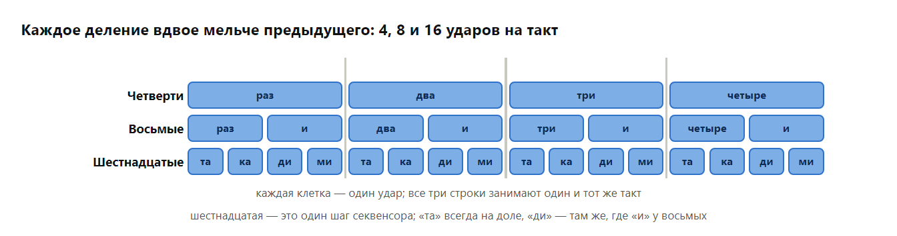
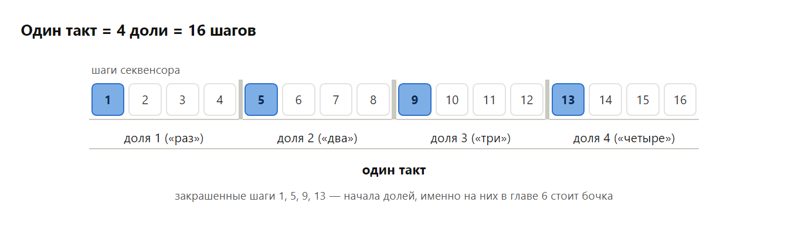
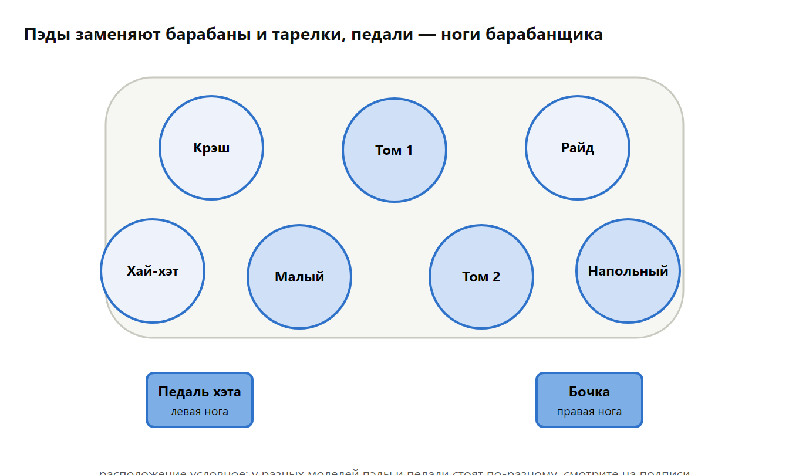
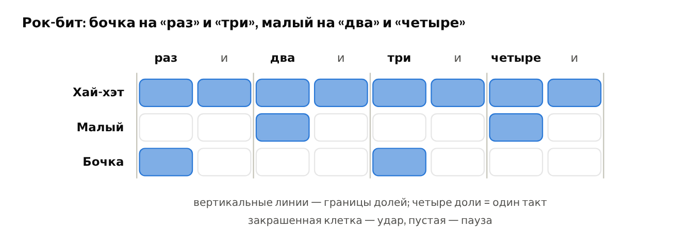
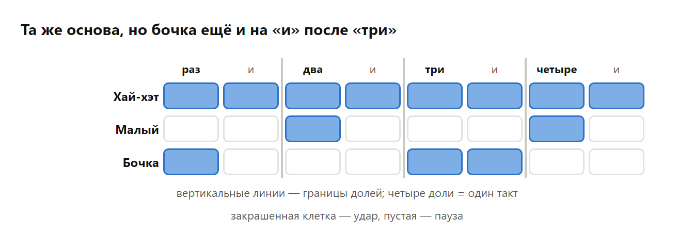
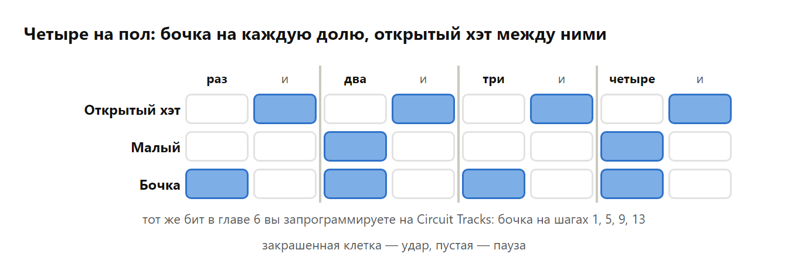
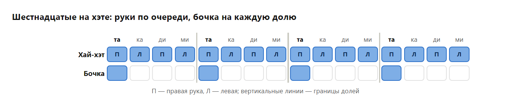
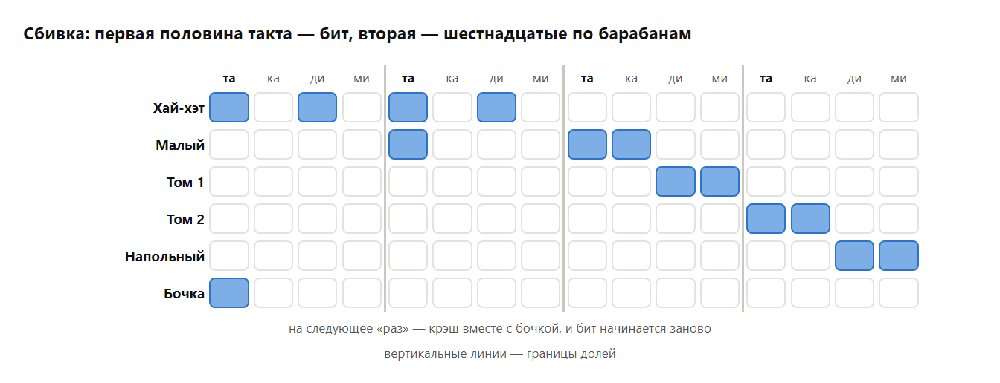

# Глава 3. Ритм и метроном

В уроке 2 вы сыграли первый бит, считая вслух под метроном. Эта глава объясняет, что именно вы считали: как музыка делится на доли и такты, как долю дробят на всё более мелкие части и как заниматься с метрономом, чтобы играть ровно. В конце — урок на ударной установке: на электронной, если она есть, или на столе и полу, как в уроке 2.

## 3.1. Доля, такт, темп

**Доля** (beat) — равномерный пульс музыки, то, под что хочется хлопать или кивать головой. Доли идут с одинаковым промежутком, как тиканье часов. **Темп** (tempo) — скорость этого тиканья, его меряют в **BPM** (beats per minute, долей в минуту): 60 BPM — одна доля в секунду, 120 BPM — две.

Доли группируются в **такты** (bars). В популярной и электронной музыке почти всегда по четыре: «раз-два-три-четыре», и на следующем «раз» начинается новый такт. Первая доля такта самая сильная, на ней обычно начинаются новые части и звучит тарелка.

Удар можно поставить на долю или между долями, а можно не ставить ничего — тогда на этом месте тишина, **пауза** (rest). Паузы так же важны, как звуки: **ритм** (rhythm) и есть чередование звуков и пауз разной длины на фоне ровных долей.

> 👂 **Попробуйте.** Включите любимую песню и хлопайте на каждую долю, считая вслух «раз-два-три-четыре». Найдите, где начинается такт: обычно на «раз» звучит бочка и меняется аккорд. Потом хлопайте только на «два» и «четыре» — скорее всего, вы попадёте в малый барабан. Напоследок оцените темп: сколько хлопков выходит за 15 секунд? Умножьте на 4 — это примерный BPM песни.

## 3.2. Деление доли

Долю можно разделить на равные части, и у каждого деления есть своё имя и свой счёт:

| Деление | Ударов на долю | Ударов на такт | Как считать |
| --- | --- | --- | --- |
| **Четверти** (quarter notes) | 1 | 4 | «раз, два, три, четыре» |
| **Восьмые** (eighth notes) | 2 | 8 | «раз-и, два-и, три-и, четыре-и» |
| **Шестнадцатые** (sixteenth notes) | 4 | 16 | «та-ка-ди-ми, та-ка-ди-ми…» |

Названия идут от долей целой ноты: четверть — её одна четвёртая, восьмая — одна восьмая. В такте из четырёх долей как раз четыре четверти, восемь восьмых и шестнадцать шестнадцатых. У восьмых «и» стоит ровно посередине доли. У шестнадцатых каждая доля проговаривается «та-ка-ди-ми»: «та» звучит на самой доле, вместе со щелчком метронома, «ди» — посередине, там же, где «и» у восьмых, а «ка» и «ми» — между ними. Номер доли при этом не произносят, его отсчитывает метроном. Вариантов счёта шестнадцатых много, и единого правила нет (откуда они взялись — в справке ниже). В книге — «та-ка-ди-ми», но если вы уже привыкли к другому, например к «ти-ли-ти-ли» из музыкальной школы, считайте по-своему: важны не слоги, а то, чтобы все четыре были одинаковой длины.

*Четверти, восьмые и шестнадцатые в одном такте со счётом: каждое деление вдвое мельче предыдущего*

> 👂 **Попробуйте.** Поставьте метроном на 60 BPM и стучите пальцем по столу: один такт четвертями (стук на каждый щелчок), один такт восьмыми (два стука на щелчок), один такт шестнадцатыми (четыре стука). Щелчки не меняются, а музыка с каждым тактом кажется вдвое быстрее. Так в песнях создают ощущение ускорения, не меняя темп.

> 📜 **Историческая справка: откуда слоги для счёта.** Проговаривать ритм слогами придумали давно: в Южной Индии для этого есть целое искусство — [коннакол](https://en.wikipedia.org/wiki/Konnakol) (статья на англ.). В Европе в XIX веке французы Пьер Галлен, Эме Пари и Эмиль Шеве дали длительностям слоговые имена: четверть — «та», две восьмые — «та-те», четыре шестнадцатые — «та-фа-те-фе» ([система Галлена — Пари — Шеве](https://en.wikipedia.org/wiki/Galin-Paris-Chev%C3%A9_system), статья на англ.). Венгерский композитор [Золтан Кодай](https://ru.wikipedia.org/wiki/Кодай,_Золтан) переделал их в «та», «ти-ти» и «ти-ри-ти-ри»; по его системе детей учат ритму во многих странах.
>
> В США [считают](https://en.wikipedia.org/wiki/Counting_(music)) «1 e & a»: числа стоят на долях, «&» (and, «и») — посередине, «e» и «a» — на шестнадцатых. В 1996 году американские преподаватели Ричард Хоффман, Уильям Пелто и Джон Уайт предложили систему [Takadimi](https://en.wikipedia.org/wiki/Takadimi) (статья на англ.) со слогами «та-ка-ди-ми», заимствовав идею у индийской ритмики. В России для восьмых принят счёт «раз-и», а в детских музыкальных школах их часто проговаривают по-кодаевски, «ти-ти». Для шестнадцатых единого счёта нет: в одних пособиях «ти-ли-ти-ли», в других «ту-ру-ту-ру» или «ти-ри». В этой книге шестнадцатые считаются по Takadimi: короткие слоги легко проговаривать быстро, а «та» всегда приходится на долю.

Секвенсор работает с теми же делениями. В Circuit Tracks каждая доля делится на четыре **шага** (steps), то есть шаг — это шестнадцатая. В такте 4 доли по 4 шага — 16 шагов, именно поэтому у большинства грувбоксов 16 кнопок или пэдов для шагов.

*Такт из 16 шагов, сгруппированных в 4 доли*

Одинаковые удары звучат механически. Живой ритм делают две вещи. **Акцент** (accent) — удар, сыгранный громче соседних: обычно акцентируют доли, а «и» играют тише. **Свинг** (swing) — небольшое запаздывание каждого второго удара: вместо ровного «раз-и-два-и» получается раскачивающееся «ра-а-аз-и, два-а-а-и», как шаги вприпрыжку. На Circuit Tracks свинг настраивается кнопкой **Tempo** (см. 4.3).

> 👂 **Попробуйте.** Стучите по столу восьмые и говорите «раз-и-два-и» ровно, как часы. Затем растягивайте каждое число и укорачивайте «и», как будто идёте вприпрыжку: «ра-а-аз-и, два-а-а-и». Это и есть свинг. Напоследок вернитесь к ровным восьмым и бейте на числах сильнее, а на «и» слабее: ровный ряд ударов сразу начинает «идти».

## 3.3. Метроном

**Метроном** щёлкает ровно, с какой бы скоростью вы ни играли, поэтому он сразу показывает, если вы ускоряетесь или отстаёте. Где его взять:

- в электронной ударной установке или синтезаторе, в том числе детском: метроном там встречается часто, ищите кнопку с надписью «Метроном», Metronome или Click;
- в бесплатном приложении-метрономе на телефоне или планшете.

Если вы играете на электронной установке в наушниках, удобнее встроенный метроном: его щелчки идут в те же наушники. Метроном приложения из динамика телефона за звуком установки может быть не слышно.

Как заниматься:

1. Начинайте с темпа, на котором получается без ошибок, даже если он кажется скучно медленным: 60–70 BPM.
2. Прибавляйте по 5 BPM, только когда упражнение 8 тактов подряд звучит ровно.
3. Если начали сбиваться, вернитесь на предыдущий темп. Ровно и медленно полезнее, чем быстро и неровно.
4. Считайте вслух, пока счёт не начнёт звучать в голове сам.

> 👂 **Попробуйте.** Поставьте метроном на 70 BPM и хлопайте вместе с ним. Если вы попадаете точно, щелчок «исчезает» под хлопком и почти не слышен. Если щелчок слышен отдельно — до хлопка или после, — вы спешите или отстаёте. Теперь убавьте громкость метронома до нуля на 4 такта, продолжая хлопать, и верните её. Если хлопки и щелчки по-прежнему совпадают, вы держите темп сами.

## 3.4. Электронная ударная установка

**Электронная ударная установка** (electronic drum kit) заменяет барабаны и тарелки резиновыми **пэдами**, а звук берёт из памяти и отдаёт в наушники или колонки. Компактные модели сворачиваются в рулон или кладутся на стол; к ним идут палочки и две педали. Пэды обычно чувствуют силу удара: слабый удар звучит тихо, сильный — громко.

*Условная раскладка компактной электронной установки: семь пэдов и две педали. У разных моделей пэды стоят по-разному, поэтому смотрите на подписи на пэдах.*

Пэды соответствуют частям обычной установки из раздела 2.2:

| Пэд или педаль | Чем играть | Что заменяет |
| --- | --- | --- |
| Хай-хэт | правая рука | **хай-хэт** |
| Малый (snare) | левая рука | **малый барабан** |
| Томы (tom) | любая рука | **томы**: высокий, средний и напольный |
| Крэш, райд | правая рука | **крэш** и **райд** |
| Педаль бочки (kick) | правая нога | **бочку** |
| Педаль хэта (hi-hat) | левая нога | педаль хай-хэта |

Педаль хэта обычно работает как у настоящей тарелки: пока она нажата, удар по пэду хай-хэта даёт **закрытый хэт**, а если её отпустить — **открытый хэт**. На некоторых моделях педаль хэта звучит и сама, коротким «чик» сомкнутых тарелок. Если у вашей установки одна педаль, это бочка.

> 👂 **Попробуйте.** Нажмите левой ногой педаль хэта и ударьте по пэду хай-хэта: короткое «тс». Отпустите педаль и ударьте снова: длинное шипящее «тссс». Затем ударьте по малому сначала едва касаясь, потом сильно — услышите, как пэд передаёт силу удара.

> ⚠️ **Внимание.** Перед игрой в наушниках убавьте громкость установки до минимума и прибавляйте понемногу, уже ударяя по пэдам. Удар по тарелке — один из самых резких звуков, на громкости он опасен для слуха.

Если установки нет, все упражнения урока можно играть как в уроке 2: правая рука — по столу справа (хай-хэт), левая рука — по столу слева (малый), правая нога притопывает (бочка). Томы — разные места стола слева направо.

## 3.5. 🎓 Урок 3. Ритм на ударной установке

**Что понадобится:** электронная ударная установка или стол и пол, метроном. Время: 40–60 минут; урок удобно разбить на два-три дня. Все сетки читаются как в уроке 2: строки — инструменты, столбцы — время, закрашенная клетка — удар.

Сядьте так, чтобы ноги свободно доставали до педалей, а руки — до всех пэдов без наклона. Палочки держите расслабленно, большим и указательным пальцами, остальные пальцы только придерживают: палочка должна отскакивать от пэда сама.

### Шаг 1. Подготовка

Включите установку на минимальной громкости, найдите метроном и поставьте 60 BPM. Сыграйте по малому несколько ударов вместе со щелчками и подстройте громкость так, чтобы и щелчок, и удар были хорошо слышны.

- [ ] 🎯 Метроном и установка слышны одновременно, громкость комфортная

### Шаг 2. Четверти и восьмые на хэте

Правой рукой по хай-хэту (педаль хэта нажата): 4 такта четвертями, считая «раз-два-три-четыре», затем 4 такта восьмыми, считая «раз-и-два-и». Не останавливайтесь при переходе. Затем сыграйте восьмые с **акцентом**: на числах сильнее, на «и» слабее.

- [ ] 🎯 Переход от четвертей к восьмым без остановки и сбоя счёта
- [ ] 🎯 Слышна разница между сильными и слабыми ударами

### Шаг 3. Рок-бит на установке

Сыграйте рок-бит из урока 2: хэт восьмыми, бочка педалью на «раз» и «три», малый на «два» и «четыре». Темп 70 BPM.

*Сетка рок-бита из урока 2: хай-хэт восьмыми, бочка на «раз» и «три», малый на «два» и «четыре»*

- [ ] 🎯 Рок-бит 8 тактов подряд, бочка и хэт ударяют одновременно

### Шаг 4. Бочка в новом месте

Оставьте хэт и малый как были и добавьте ещё один удар бочки на «и» после «три»: «бум-тс-тыщ-тс-бум-бум-тыщ-тс». Нога теперь бьёт два раза подряд. Если она не успевает, снизьте темп до 60.

*Тот же бит, но бочка ещё и на «и» после «три»*

> 👂 **Попробуйте.** Сыграйте 4 такта обычного рок-бита, затем 4 такта с новой бочкой. Один лишний удар — и бит начинает «подталкивать» вперёд. Так барабанщики разнообразят одну и ту же основу.

- [ ] 🎯 Новый бит 8 тактов подряд, лишний удар бочки не сдвигает малый

### Шаг 5. Четыре на пол

Теперь бит, на котором стоят диско и хаус: **четыре на пол** (four on the floor) — бочка на каждую долю. Правая нога бьёт на «раз, два, три, четыре», левая рука — малый на «два» и «четыре», вместе с бочкой. Правая рука бьёт по хай-хэту только на «и», с отпущенной педалью хэта: открытый «тссс» между ударами бочки.

*Четыре на пол: бочка на каждую долю, малый на «два» и «четыре», открытый хэт на «и»*

Сначала сыграйте только бочку и хэт: «бум-тсс-бум-тсс». Когда пойдёт ровно, добавьте малый. Этот же бит вы запрограммируете на Circuit Tracks в главе 6 — там хэт будет закрытым.

- [ ] 🎯 Бочка на каждую долю, хэт точно посередине между ними, 8 тактов

### Шаг 6. Шестнадцатые

Поставьте метроном на 60 BPM. Играйте по хай-хэту шестнадцатые, чередуя руки: правая, левая, правая, левая — и считайте «та-ка-ди-ми» на каждую долю. Правая рука всегда попадает на «та» и «ди», левая — на «ка» и «ми». Когда пойдёт ровно, добавьте бочку на каждую долю.

*Шестнадцатые на хэте: руки по очереди, бочка на каждую долю*

- [ ] 🎯 Шестнадцатые звучат ровно: все четыре удара на долю одинаковой длины
- [ ] 🎯 Бочка совпадает с ударом правой руки на каждой доле

### Шаг 7. Сбивка шестнадцатыми

В уроке 2 сбивка шла восьмыми. Теперь сыграйте её шестнадцатыми. Играйте рок-бит три такта. В четвёртом такте на «раз» и «два» играйте бит, а на «три» и «четыре» — восемь шестнадцатых, по два удара на каждый барабан сверху вниз: малый, том 1, том 2, напольный. Руки чередуются: правая, левая. На следующее «раз» ударьте по крэшу вместе с бочкой и начните бит заново.

*Сбивка: первая половина такта — бит, вторая — шестнадцатые по барабанам сверху вниз, затем крэш на «раз»*

- [ ] 🎯 Сбивка не ускоряется, крэш попадает точно на «раз»

### Шаг 8. Лестница темпа

Сыграйте рок-бит и «четыре на пол» по 8 тактов на 70 BPM. Если всё ровно, поставьте 80, затем 90 и 100. На следующую ступеньку переходите, только когда текущая звучит без ошибок. 100 BPM — темп урока на Circuit Tracks в главе 6.

- [ ] 🎯 Оба бита ровно звучат на 100 BPM

### Если что-то не получается

| Что происходит | Что делать |
| --- | --- |
| Ускоряюсь к концу упражнения | Снизьте темп на 10 BPM и считайте вслух. Проверьте себя по 👂 из раздела 3.3. |
| Рука и нога не попадают вместе | Играйте только хэт и бочку, без малого, на 60 BPM, пока удары не сольются в один. |
| Пэд не срабатывает или срабатывает дважды | Бейте в центр пэда. У многих установок можно настроить чувствительность пэдов: смотрите инструкцию к вашей модели. |
| Устают руки | Держите палочки слабее и бейте от кисти, а не от плеча. Делайте перерыв каждые 10–15 минут. |
| Не слышно метронома | Включите встроенный метроном установки или сделайте приложение громче. |

**Домашнее задание:** 10 минут в день играйте шаги 3, 5 и 6 под метроном. Через неделю попробуйте сыграть бит под любимую песню: найдите её темп, как в 👂 из раздела 3.1, и выставьте его на метрономе.

---

← [Глава 2. Музыкальные инструменты](02-instrumenty.md) · [Оглавление](README.md) · [Глава 4. Электронные инструменты](04-elektronnye-instrumenty.md) →
