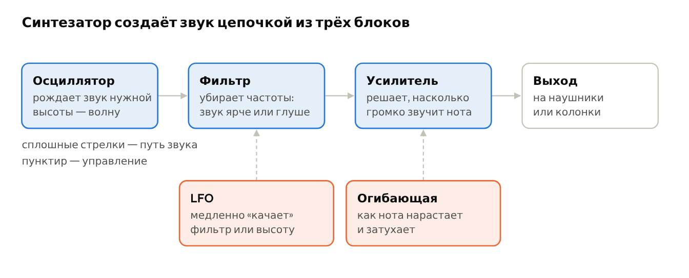
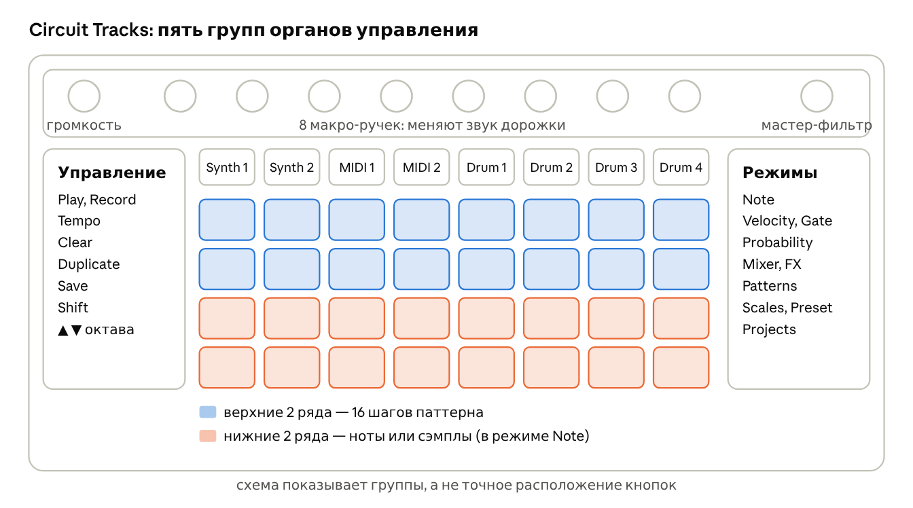

# Глава 4. Электронные инструменты

Акустическому инструменту звук даёт струна, воздух или мембрана. Электронный инструмент создаёт звук электрическим сигналом и отдаёт его в наушники или колонки. Этот сигнал можно рождать с нуля, проигрывать из записи и запоминать, чтобы инструмент играл сам.

## 4.1. Основные виды электронных инструментов

| Инструмент | Что делает | Изображение |
| --- | --- | --- |
| [**Синтезатор**](https://ru.wikipedia.org/wiki/Синтезатор) | создаёт звук с нуля из электрических колебаний; меняя настройки, из одного прибора можно получить бас, «скрипку», «космический» гул |  На фото — Minimoog · Vincent Liu · [CC BY 2.0](https://creativecommons.org/licenses/by/2.0/deed.ru) · [файл](https://commons.wikimedia.org/wiki/File:Minimoog_@_Moogseum,_NAMM_2010.jpg) |
| [**Драм-машина**](https://ru.wikipedia.org/wiki/Драм-машина) | играет барабанные партии; самая знаменитая — [Roland TR-808](https://en.wikipedia.org/wiki/Roland_TR-808) (статья на англ.) 1980 года, её звуки до сих пор слышны в хип-хопе и поп-музыке |  На фото — Roland TR-808 · fr4dd · [CC BY 2.0](https://creativecommons.org/licenses/by/2.0/deed.ru) · [файл](https://commons.wikimedia.org/wiki/File:Roland_TR-808_Rhythm_Composer.jpg) |
| [**Сэмплер**](https://ru.wikipedia.org/wiki/Сэмплер) | проигрывает **сэмплы** — короткие записи реальных звуков: удара барабана, голоса, аккорда |  На фото — E-mu Emulator II+ · Mojosynths · общественное достояние · [файл](https://commons.wikimedia.org/wiki/File:E-mu_Emulator_II%2B_%28rectified,_colours_improved%29.jpg) |
| [**Секвенсор**](https://en.wikipedia.org/wiki/Music_sequencer) (статья на англ.) | запоминает, какие ноты и когда играть, и воспроизводит их по кругу; на нём строится **паттерн** |  На фото — Korg SQ-1 · Pete Brown · [CC BY 2.0](https://creativecommons.org/licenses/by/2.0/deed.ru) · [файл](https://commons.wikimedia.org/wiki/File:Korg_SQ-1_step_sequencer_-_1_-_2015_NAMM_Show.jpg) |
| **Грувбокс** (groovebox) | всё вместе в одном корпусе: синтезатор, драм-машина и секвенсор. Circuit Tracks — грувбокс |  На фото — Roland MC-505 · Hens Zimmerman · [CC BY 2.0](https://creativecommons.org/licenses/by/2.0/deed.ru) · [файл](https://commons.wikimedia.org/wiki/File:Roland_MC-505.jpg) |
| [**MIDI**](https://ru.wikipedia.org/wiki/MIDI) | не инструмент, а «язык», на котором приборы передают друг другу команды: «нажата нота `до`, вот так сильно», «нота отпущена». Сам MIDI звука не содержит |  На фото — MIDI-разъёмы и кабель · Pretzelpaws · [CC BY-SA 3.0](https://creativecommons.org/licenses/by-sa/3.0/deed.ru) · [файл](https://commons.wikimedia.org/wiki/File:Midi_ports_and_cable.jpg) |

## 4.2. Как синтезатор делает звук

У большинства синтезаторов внутри одна и та же цепочка. **Осциллятор** (oscillator) создаёт простую волну нужной высоты. **Фильтр** (filter) убирает из неё часть частот: открытый фильтр звучит ярко, закрытый — глухо, как через подушку. **Усилитель** (amplifier) решает, насколько громко звучит нота в каждый момент. Ими управляют два «помощника»: **огибающая** (envelope) задаёт, как звук нарастает после нажатия и как затухает после отпускания, а **LFO** (low-frequency oscillator, низкочастотный генератор) медленно и ритмично «покачивает» фильтр или высоту.

*Цепочка синтезатора: осциллятор, фильтр и усилитель, которыми управляют LFO и огибающая*

Когда вы крутите ручки на синтезаторе, вы почти всегда меняете что-то в этой цепочке. Набор всех настроек, сохранённый под одним именем, называется **пресет** (preset, или патч): «мягкий бас», «яркий лид» и так далее.

> 👂 **Попробуйте** (когда пройдёте урок 4 ниже). На Circuit Tracks выберите Synth 1, держите любой пэд в режиме Note и медленно крутите макро-ручки по одной. Ручка, от которой звук становится то глухим, то ярким и звонким, скорее всего управляет фильтром. Ручка, от которой нота начинает плавно выплывать или долго тянуться после отпускания, — огибающая. Ручка, от которой звук начинает «пульсировать» или «плавать», — LFO. Какие именно параметры стоят на ручках, зависит от пресета, поэтому попробуйте два-три разных.

## 4.3. Знакомство с Novation Circuit Tracks

Circuit Tracks — это грувбокс размером с книгу. В нём есть:

- две синтезаторные дорожки (Synth 1 и Synth 2) — для баса, аккордов и мелодий;
- четыре барабанные дорожки (Drum 1, Drum 2, Drum 3, Drum 4) — каждая играет **сэмплы**;
- две MIDI-дорожки — чтобы управлять другими инструментами по MIDI;
- секвенсор: каждая дорожка играет **паттерн** до 32 шагов, паттерны соединяются в цепочки, а из цепочек собирается песня.

Экрана нет: всё, что нужно знать, прибор показывает цветом и яркостью пэдов. Каждая дорожка имеет свой цвет, и он сохраняется во всех режимах. Надписи серым цветом на корпусе — это вторые функции кнопок, они работают при зажатой **Shift**.

*Упрощённая схема Circuit Tracks: ручки, выбор дорожки, сетка пэдов, кнопки управления и режимов*

Точная раскладка кнопок с подписями есть в официальном [руководстве пользователя Novation](https://userguides.novationmusic.com/hc/en-gb/articles/25494476280850-Circuit-Tracks-hardware-overview). Иллюстрации оттуда принадлежат Novation и не распространяются под свободной лицензией, поэтому в книге вместо них наша упрощённая схема.

| Кнопка | Что делает |
| --- | --- |
| **Play** | запускает и останавливает воспроизведение |
| **Record** | включает запись: всё, что вы играете и крутите, записывается в паттерн |
| **Tempo** | задаёт **темп** и **свинг** |
| **Clear** | удаляет: зажмите и нажмите шаг или паттерн |
| **Duplicate** | копирует паттерн или шаг |
| **Save** | сохраняет проект (нажать два раза) |
| **Note** | режим игры: нижние ряды становятся клавиатурой или пэдами сэмплов |
| **Velocity**, **Gate**, **Probability** | сила удара, длительность и вероятность для каждого шага |
| **Mixer** | громкость дорожек и их выключение (**мьют**) |
| **FX** | эффекты: **реверберация** и **задержка** (эхо) |
| **Patterns** | выбор паттернов и соединение их в цепочки |
| **Scales** | выбор **лада** для синтезаторных дорожек |
| **Preset** | выбор звука (пресета) для выбранной дорожки |
| **Projects** | выбор проекта; 16 первых — заводские демо |
| **▲ ▼** | сдвиг клавиатуры на октаву вверх и вниз |

## 4.4. 🎓 Урок 4. Первое знакомство: понажимать и послушать

Цель урока — ничего не создавать, а освоиться: понять, где что находится, и послушать все звуки прибора. Время: 40–60 минут. Сломать или испортить что-то нельзя, пока вы не нажимаете **Save**.

### Шаг 1. Включение и громкость

Подключите наушники или колонки, поверните ручку громкости почти до минимума и включите прибор. Громкость прибавляйте понемногу уже во время воспроизведения.

> ⚠️ **Внимание.** Перед включением всегда убавляйте громкость прибора и колонок. Внезапный громкий звук в наушниках опасен для слуха и для динамиков.

- [ ] 🎯 Прибор включён, звук идёт в наушники или колонки

### Шаг 2. Демо-проекты

Нажмите **Projects**, выберите любой из первых 16 пэдов и нажмите **Play**. Пока играет музыка, нажимайте другие пэды проектов: прибор доиграет текущий фрагмент и перейдёт к новому. Нажмите **Play** ещё раз, чтобы остановить.

- [ ] 🎯 Послушал не меньше пяти демо

### Шаг 3. Дорожки и цвета

Запустите демо и по очереди нажимайте кнопки дорожек: Synth 1, Synth 2, Drum 1, Drum 2, Drum 3, Drum 4. Посмотрите, как меняется цвет пэдов и рисунок огоньков: каждая дорожка играет свою **партию**, а бегущий огонёк показывает текущий **шаг**.

- [ ] 🎯 Запомнил цвета синтезаторных и барабанных дорожек

### Шаг 4. Микшер

Нажмите **Mixer** и выключайте дорожки по одной, пока не останется только одна. Послушайте каждую партию отдельно, затем включите все обратно. Так проще всего понять, из чего состоит трек.

- [ ] 🎯 Послушал каждую дорожку отдельно

### Шаг 5. Каталог барабанных сэмплов

Остановите воспроизведение. Выберите **Drum 1** и нажмите **Note**. Нижние два ряда — это 16 сэмплов одного набора. Нажимайте их по одному. Порядок во всех заводских наборах одинаковый: 1–2 — бочки, 3–4 — малые барабаны, 5–6 — закрытые хэты, 7–8 — открытые хэты, 9–12 — перкуссия, 13–16 — мелодические звуки. Наборов четыре, они листаются стрелками ▲ и ▼. Отметьте в таблице номера понравившихся сэмплов, они пригодятся в главе 6.

| Набор | Любимая бочка (1–2) | Любимый малый (3–4) | Любимый хэт (5–8) | Интересный звук (9–16) |
| --- | --- | --- | --- | --- |
| 1 |  |  |  |  |
| 2 |  |  |  |  |
| 3 |  |  |  |  |
| 4 |  |  |  |  |

- [ ] 🎯 Прослушал все 64 сэмпла и заполнил таблицу

### Шаг 6. Звуки синтезатора

Выберите **Synth 1**, нажмите **Preset** и прослушайте несколько пресетов. Затем нажмите **Note** и поиграйте на нижних рядах как на клавиатуре. Стрелками ▲ ▼ сдвиньте звук на октаву вниз и вверх: одни пресеты лучше звучат низко (бас), другие высоко (**лид**).

- [ ] 🎯 Нашёл один басовый и один мелодический пресет

### Шаг 7. Макро-ручки

Держа пэд нажатым, медленно поверните каждую из восьми **макро-ручек** и слушайте, что меняется: яркость, длина звука, «дрожание». Это и есть фильтр, огибающая и LFO из схемы синтезатора, только собранные в удобные ручки.

- [ ] 🎯 Понимаю, что примерно делает каждая ручка в выбранном пресете

Проект после урока сохранять не нужно: в главе 6 мы начнём с чистого листа.

---

← [Глава 3. Ритм и метроном](03-ritm-i-metronom.md) · [Оглавление](README.md) · [Глава 5. Как устроена мелодия](05-kak-ustroena-melodiya.md) →
