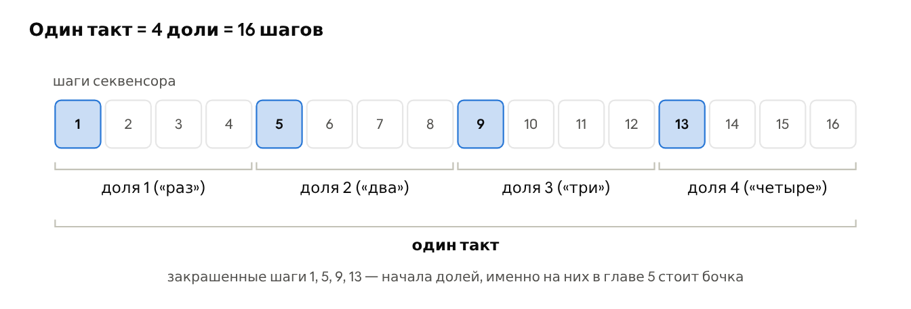

# Глава 4. Как устроена мелодия

В первых трёх главах мы узнали, из чего сделана музыка и на чём её играют. Эта глава собирает всё вместе: как устроена мелодия и из чего состоит короткий электронный трек. После неё можно садиться за урок из главы 5.

## 4.1. Ритм: доля, такт, шаг, темп

**Доля** (beat) — равномерный пульс музыки, то, под что хочется хлопать или кивать головой. Доли идут с одинаковым промежутком, как тиканье часов. **Темп** (tempo) — скорость этого тиканья, его меряют в **BPM** (beats per minute, долей в минуту): 60 BPM — одна доля в секунду, 120 BPM — две.

Доли группируются в **такты** (bars). В популярной и электронной музыке почти всегда по четыре: «раз-два-три-четыре», и на следующем «раз» начинается новый такт. Первая доля такта самая сильная, на ней обычно начинаются новые части и звучит тарелка.

Секвенсор делит время ещё мельче. В уроке 2 мы делили каждую долю на две клетки («раз-и»), а в Circuit Tracks каждая доля делится на четыре **шага** (steps). В такте 4 доли по 4 шага — 16 шагов, именно поэтому у большинства грувбоксов 16 кнопок или пэдов для шагов.

*Такт из 16 шагов, сгруппированных в 4 доли*

На шаг можно поставить удар или ноту, а можно оставить пустым — тогда на нём тишина, **пауза** (rest). Паузы так же важны, как звуки: ритм и есть чередование звуков и пауз разной длины.

> 👂 **Попробуйте.** Включите любимую песню и хлопайте на каждую долю, считая вслух «раз-два-три-четыре». Найдите, где начинается такт: обычно на «раз» звучит бочка и меняется аккорд. Потом хлопайте только на «два» и «четыре» — скорее всего, вы попадёте в малый барабан. Напоследок оцените темп: сколько хлопков выходит за 15 секунд? Умножьте на 4 — это примерный BPM песни.

## 4.2. Мелодия, фраза, вопрос и ответ

**Мелодия** (melody) — последовательность нот разной высоты и длины, которую можно напеть. Если нарисовать её точками, где высота точки — высота ноты, получится ломаная линия — **контур** (contour) мелодии. По нему видно, куда мелодия идёт: вверх, вниз, крутится на месте.

Мелодия делится на **фразы** (phrases) — куски, после которых хочется сделать вдох, как предложения в речи. Чаще всего фразы идут парами: первая звучит как **вопрос**, вторая — как **ответ** (по-английски такая пара называется call and response). Разницу создаёт последняя нота фразы.

*Контур двух фраз мелодии: вопрос останавливается на соль, ответ приходит на до*

Ступени лада звучат по-разному устойчиво:

| Ступени | В до мажоре | Как звучит конец фразы на них |
| --- | --- | --- |
| 1 (тоника) | до | завершённо, точка |
| 3 и 5 | ми, соль | спокойно, но не окончательно: запятая |
| 2, 4, 6, 7 | ре, фа, ля, си | **неустойчиво**: слух ждёт продолжения |

Устойчивые ступени 1, 3 и 5 — это ровно ноты главного **трезвучия** лада (до-ми-соль), так что мелодия и **гармония** связаны напрямую. В миноре всё то же самое: в до миноре устойчивы до, ми♭ и соль.

Из этого следуют четыре практических правила для первой мелодии:

1. Ответ заканчивайте на тонике, вопрос — на любой другой ступени.
2. Двигайтесь в основном на соседние ступени, а скачки делайте редко: так мелодию легче запомнить и напеть.
3. Повторяйте ритм, меняя ноты: в обеих фразах примера выше одинаковый ритм, и это связывает их в целое.
4. Оставляйте паузы между фразами: мелодии нужно «дышать».

> 👂 **Попробуйте.** Сыграйте первую фразу «Ах, скажу я вам, мама» (до до соль соль ля ля соль) и остановитесь. Послушайте тишину пару секунд: она звучит как недосказанная мысль. Теперь сыграйте вторую фразу до конца (фа фа ми ми ре ре до) — слышно облегчение. А теперь оборвите вторую фразу на ре: ответ сразу превращается в ещё один вопрос. Напоследок придумайте свой ответ на первую фразу: любые семь нот, лишь бы последняя была до.

## 4.3. Из чего состоит трек

Короткий электронный трек собирается из нескольких одновременных **партий** (parts), каждая звучит своим инструментом и делает свою работу. На Circuit Tracks каждая партия живёт на своей дорожке.

| Партия | Работа | Дорожка в главе 5 |
| --- | --- | --- |
| Барабаны (**бит**) | держат ритм и темп | Drum 1–3 |
| **Бас** | показывает гармонию снизу, связывает барабаны с мелодией | Synth 1 |
| **Мелодия** (часто играет **лид**) | то, что запоминается | Synth 2 |
| Аккорды (часто тянущийся **пэд**) | фон и настроение | пока не нужны |

> 👂 **Попробуйте.** Запустите любое демо на Circuit Tracks, откройте Mixer и выключайте дорожки по одной, а потом включайте обратно. Без барабанов трек перестаёт «идти», без баса становится лёгким и пустым снизу, без мелодии остаётся фон, который хочется чем-то заполнить. Так на слух становится понятна работа каждой партии из таблицы.

> 💡 **Сэмпл или синтез: в чём разница?** Барабанные дорожки Circuit Tracks играют **сэмплы** — готовые записи коротких звуков. Сэмпл звучит всегда одинаково, и для барабанов это то, что нужно. Синтезаторные дорожки создают звук заново на каждую ноту и могут сыграть любую высоту, поэтому на них играют бас и мелодию.

**Как устроена запись на грувбоксе.** Слова, которые встретятся в главе 5, складываются в цепочку от малого к большому:

| Понятие | Что это |
| --- | --- |
| **Шаг** | одна клетка секвенсора |
| **Паттерн** | записанная партия одной дорожки, обычно длиной в такт |
| **Луп** | то, что получается, когда паттерны всех дорожек повторяются по кругу |
| **Вариация** | копия паттерна с небольшими изменениями, чтобы повтор не надоел |
| **Цепочка** | несколько паттернов одной дорожки, играющих по очереди |
| **Сцена** | запомненное сочетание цепочек всех дорожек: куплет, припев, брейк |

Наконец, три детали делают партию живой. **Динамика** (dynamics) — разная сила нот (в Circuit Tracks её задаёт **Velocity**). **Длительность** (duration) — короткие или тянущиеся ноты (**Gate**). **Случайность** (randomness) — нота, которая иногда пропускается (**Probability**). Все три понадобятся в уроке.
