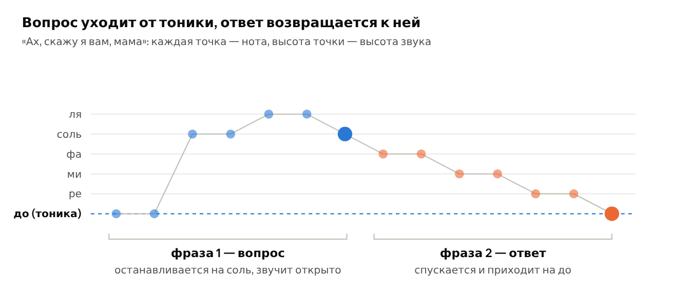

# Глава 5. Как устроена мелодия

В первых четырёх главах мы узнали, из чего сделана музыка, как устроен ритм и на чём её играют. Эта глава собирает всё вместе: как устроена мелодия и из чего состоит короткий электронный трек. В конце — урок на слух, а после главы можно садиться за урок из главы 6.

## 5.1. Мелодия, фраза, вопрос и ответ

**Мелодия** (melody) — последовательность нот разной высоты и длины, которую можно напеть. Если нарисовать её точками, где высота точки — высота ноты, получится ломаная линия — **контур** (contour) мелодии. По нему видно, куда мелодия идёт: вверх, вниз, крутится на месте.

Мелодия делится на **фразы** (phrases) — куски, после которых хочется сделать вдох, как предложения в речи. Чаще всего фразы идут парами: первая звучит как **вопрос**, вторая — как **ответ** (по-английски такая пара называется call and response). Разницу создаёт последняя нота фразы.

*Контур двух фраз мелодии: вопрос останавливается на `соль`, ответ приходит на `до`*

Ступени лада звучат по-разному устойчиво:

| Ступени | В `до` мажоре | Как звучит конец фразы на них |
| --- | --- | --- |
| 1 (тоника) | `до` | завершённо, точка |
| 3 и 5 | `ми`, `соль` | спокойно, но не окончательно: запятая |
| 2, 4, 6, 7 | `ре`, `фа`, `ля`, `си` | **неустойчиво**: слух ждёт продолжения |

Устойчивые ступени 1, 3 и 5 — это ровно ноты главного **трезвучия** лада (`до`-`ми`-`соль`), так что мелодия и **гармония** связаны напрямую. В миноре всё то же самое: в `до` миноре устойчивы `до`, `ми♭` и `соль`.

Из этого следуют четыре практических правила для первой мелодии:

1. Ответ заканчивайте на тонике, вопрос — на любой другой ступени.
2. Двигайтесь в основном на соседние ступени, а скачки делайте редко: так мелодию легче запомнить и напеть.
3. Повторяйте ритм, меняя ноты: в обеих фразах примера выше одинаковый ритм, и это связывает их в целое.
4. Оставляйте паузы между фразами: мелодии нужно «дышать».

> 👂 **Попробуйте.** Сыграйте первую фразу «Ах, скажу я вам, мама» (`до до соль соль ля ля соль`) и остановитесь. Послушайте тишину пару секунд: она звучит как недосказанная мысль. Теперь сыграйте вторую фразу до конца (`фа фа ми ми ре ре до`) — слышно облегчение. А теперь оборвите вторую фразу на `ре`: ответ сразу превращается в ещё один вопрос. Напоследок придумайте свой ответ на первую фразу: любые семь нот, лишь бы последняя была `до`.

## 5.2. Из чего состоит трек

Короткий электронный трек собирается из нескольких одновременных **партий** (parts), каждая звучит своим инструментом и делает свою работу. На Circuit Tracks каждая партия живёт на своей дорожке.

| Партия | Работа | Дорожка в главе 6 |
| --- | --- | --- |
| Барабаны (**бит**) | держат ритм и темп | Drum 1–3 |
| **Бас** | показывает гармонию снизу, связывает барабаны с мелодией | Synth 1 |
| **Мелодия** (часто играет **лид**) | то, что запоминается | Synth 2 |
| Аккорды (часто тянущийся **пэд**) | фон и настроение | пока не нужны |

> 👂 **Попробуйте.** Запустите любое демо на Circuit Tracks, откройте Mixer и выключайте дорожки по одной, а потом включайте обратно. Без барабанов трек перестаёт «идти», без баса становится лёгким и пустым снизу, без мелодии остаётся фон, который хочется чем-то заполнить. Так на слух становится понятна работа каждой партии из таблицы.

> 💡 **Сэмпл или синтез: в чём разница?** Барабанные дорожки Circuit Tracks играют **сэмплы** — готовые записи коротких звуков. Сэмпл звучит всегда одинаково, и для барабанов это то, что нужно. Синтезаторные дорожки создают звук заново на каждую ноту и могут сыграть любую высоту, поэтому на них играют бас и мелодию.

**Как устроена запись на грувбоксе.** Слова, которые встретятся в главе 6, складываются в цепочку от малого к большому:

| Понятие | Что это |
| --- | --- |
| **Шаг** | одна клетка секвенсора |
| **Паттерн** | записанная партия одной дорожки, обычно длиной в такт |
| **Луп** | то, что получается, когда паттерны всех дорожек повторяются по кругу |
| **Вариация** | копия паттерна с небольшими изменениями, чтобы повтор не надоел |
| **Цепочка** | несколько паттернов одной дорожки, играющих по очереди |
| **Сцена** | запомненное сочетание цепочек всех дорожек: куплет, припев, брейк |

Наконец, три детали делают партию живой. **Динамика** (dynamics) — разная сила нот (в Circuit Tracks её задаёт **Velocity**). **Длительность** (duration) — короткие или тянущиеся ноты (**Gate**). **Случайность** (randomness) — нота, которая иногда пропускается (**Probability**). Все три понадобятся в уроке.

## 5.3. 🎓 Урок 5. Мелодия на слух

**Что понадобится:** клавиатура (любая, хоть приложение) и напарник — или опыт на сайте книги, который загадывает сам. Время: 10–15 минут в день, неделю-другую. Уровни идут от простого к сложному; переходите на следующий, когда угадываете 8 раз из 10.

Вдвоём это делается так: один играет задание, другой отвечает, не глядя на клавиши. Всё — в `до` мажоре, на белых клавишах первой октавы.

> 💡 **Учат ли слышать мелодии?** Да. В музыкальной школе этим занимается сольфеджио: определяют на слух интервалы и аккорды, записывают услышанную мелодию (музыкальный диктант) и подбирают её на инструменте. Почти никто не слышит ноту «саму по себе» — это абсолютный слух, он встречается редко. Зато слышать ноту относительно тоники («это третья ступень, она спокойная, а это седьмая, она тянется к тонике») можно натренировать каждому, и именно этому учат упражнения ниже.

### Шаг 1. Выше или ниже

Напарник играет две ноты подряд. Скажите, вторая выше или ниже первой. Если трудно, пропойте обе.

- [ ] 🎯 8 из 10 верно

### Шаг 2. Шаг или скачок

Две ноты: соседние ступени (`до`–`ре`, `ми`–`фа`) или через одну и больше (`до`–`ми`, `ре`–`соль`)? Шаг звучит как «соседняя ступенька», скачок — как прыжок.

- [ ] 🎯 8 из 10 верно

### Шаг 3. Вопрос или ответ

Напарник играет короткую фразу из пяти нот. Последняя — `до` (ответ, точка) или другая (вопрос, многоточие)? Это те же вопрос и ответ из раздела 5.1.

- [ ] 🎯 8 из 10 верно

### Шаг 4. Какая ступень

Напарник играет вместе `до + ми + соль`, а потом одну ноту из `до ре ми фа соль`. Назовите её. Аккорд нужен, чтобы ухо «поселилось» в ладу и слышало ноту относительно тоники.

- [ ] 🎯 8 из 10 верно

### Шаг 5. Подбери три ноты

Напарник играет три ноты, первая — `до`. Подберите их на клавиатуре.

- [ ] 🎯 Подбираю с первой-второй попытки

### Шаг 6. Подбери пять нот

То же, но пять нот. Когда получается, попробуйте подобрать начало знакомой мелодии из урока 1 — «Ах, скажу я вам, мама» или «Оду к радости».

- [ ] 🎯 Подбираю пять нот и начало знакомой мелодии

<em>Ниже опыт сам загадывает задания всех шести уровней и считает ответы.</em>

---

← [Глава 4. Электронные инструменты](04-elektronnye-instrumenty.md) · [Оглавление](README.md) · [Глава 6. Урок на Circuit Tracks](06-urok-circuit-tracks.md) →
